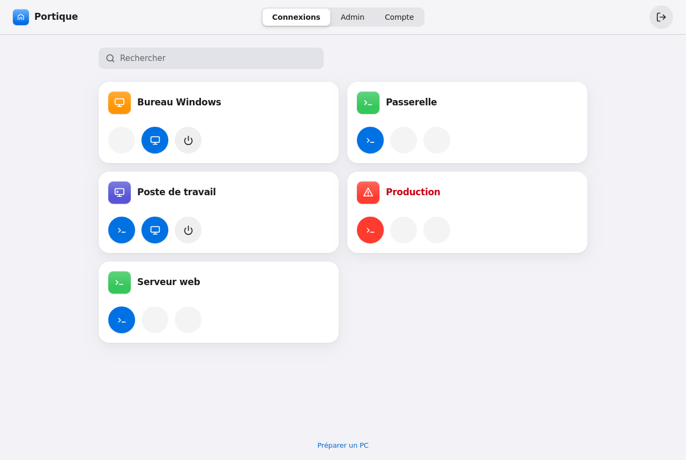
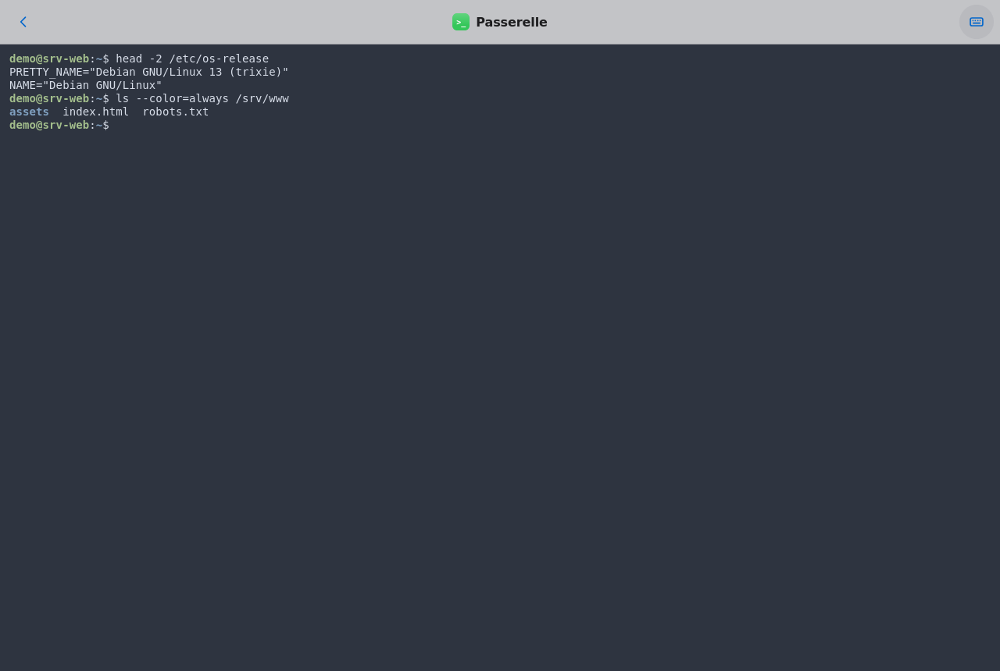
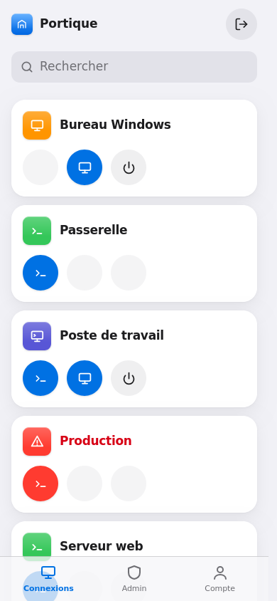
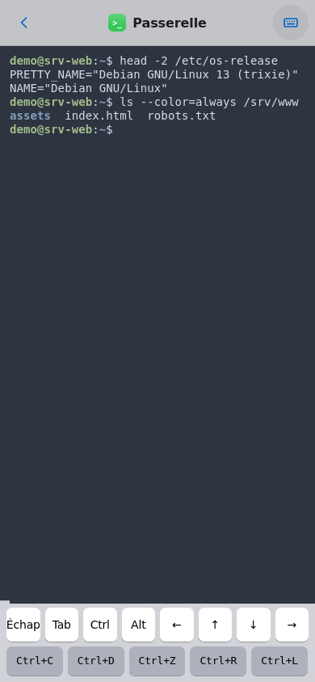
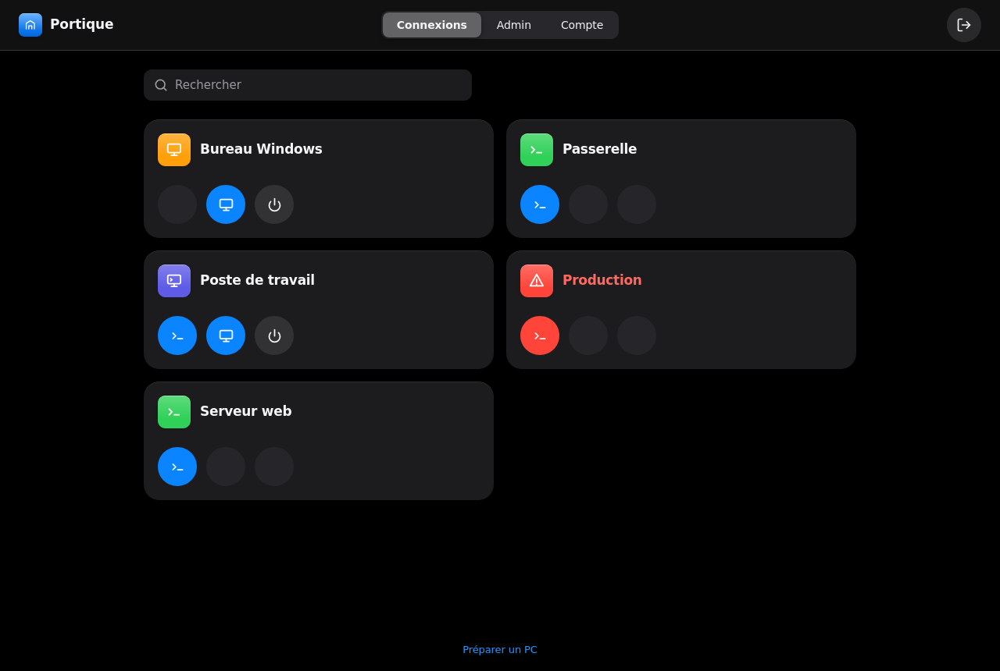
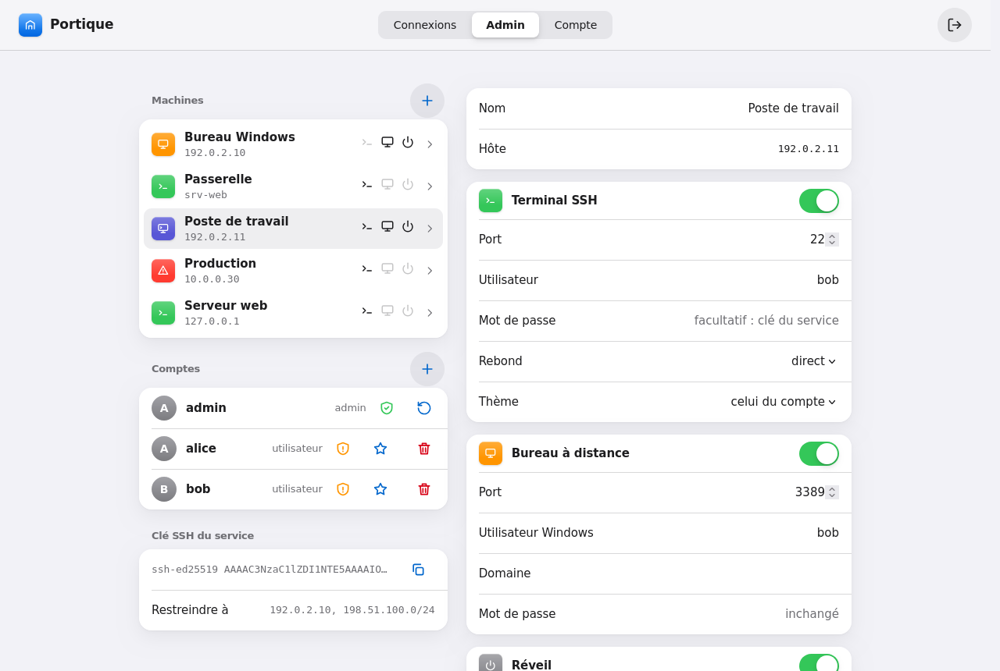
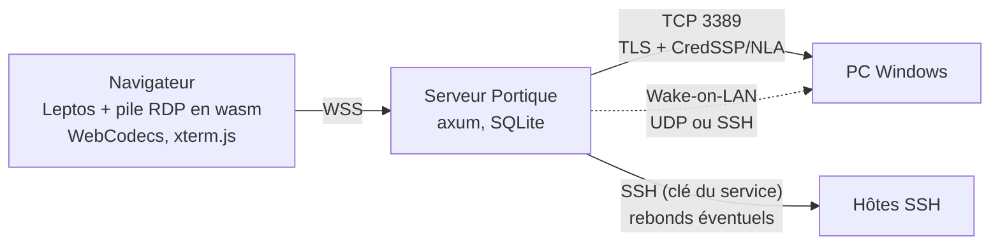

<div align="center">


# Portique

**Tes machines dans un navigateur** : bureau Windows en RDP et terminal SSH, sans Java, sans guacd, sans plugin.


</div>

<p align="center">
  
  
</p>

Portique est un accès web auto-hébergé à tes machines, écrit en Rust de bout en bout. Une tuile par machine :
le bureau Windows en RDP, un terminal en SSH, ou les deux au choix. Un seul petit binaire côté serveur, et un
navigateur côté client, ordinateur ou téléphone.

- **RDP sans compromis** : la pile RDP est **écrite à partir des spécifications Microsoft**, sans crate RDP tierce.
  Le serveur fait la connexion authentifiée puis ne fait que relayer les octets. Le navigateur décode l'image,
  H.264 compris, par WebCodecs : le GPU du client fait le travail.
- **SSH sans clé à distribuer** : une clé du service, posée une fois sur chaque hôte, des rebonds en chaîne, et
  une barre de touches pensée pour le téléphone.
- **Sûr par défaut** : identifiants jamais envoyés au navigateur, certificats et clés d'hôte épinglés après
  approbation, double authentification, CSP stricte.

## Pourquoi pas Guacamole ?

|  | Apache Guacamole | Portique |
|---|---|---|
| Côté serveur | Tomcat (Java) + guacd (C) + base de données | un binaire Rust, image d'environ 100 Mo (amd64, arm64) |
| Image du bureau | décodée sur le serveur, réencodée en PNG/JPEG | décodée dans le navigateur ; H.264 par le GPU du client |
| Identifiants Windows | transmis à guacd | ne quittent jamais le serveur (NLA faite côté serveur) |
| Presse-papier | texte | texte, HTML et images, dans les deux sens |
| SSH | clé ou mot de passe par connexion | clé du service, rebonds enchaînés, barre de touches mobile |

## Fonctions

**Bureau à distance (RDP)**

- Affichage EGFX : ClearCodec, Planar, RemoteFX Progressive, **H.264 AVC420 et AVC444** (4:4:4) décodés par
  WebCodecs, conversion des couleurs BT.709 pleine plage faite dans le wasm. Quand le navigateur ne rend que du
  RGB (Firefox), l'image 4:4:4 est recomposée si sa conversion s'inverse ; sinon la vue 4:2:0 reste. Le menu de
  session dit le chemin d'image réellement utilisé et propose « Netteté maximale » (sans H.264 sur l'appareil).
- Presse-papier texte, HTML et images dans les deux sens ; résolution qui suit la fenêtre ; multi-écran (une
  fenêtre par écran) ; plein écran avec capture du clavier (Alt+Tab, touche Windows) ; Ctrl+Alt+Suppr.
- Reconnexion automatique ; ouverture rapide même sur un lien lointain (jointure des canaux évitée quand
  Windows le permet).
- **Sur iPhone et iPad** : bouton clavier déplaçable avec un bouton de déconnexion, et barre de touches au-dessus
  du clavier (Échap, Tab, Ctrl/Alt/Win collants, flèches, Suppr, F1-F12, Ctrl+Alt+Suppr) ; toucher pour cliquer,
  appui long pour le clic droit, deux doigts pour défiler, pincer pour zoomer la vue.
- **Wake-on-LAN** : « Direct » (paquet magique) ou « Rebond » : une commande lancée par un hôte SSH du réseau
  du PC, hôte connu de la liste ou hôte saisi pour cette machine. Utile quand le paquet magique ne peut pas
  atteindre le PC tout seul : à travers un VPN routé, par exemple, sans diffusion dirigée vers son sous-réseau.
- Préparation du PC **sans rien installer** : la page `/setup/` fournit des scripts (.reg + .cmd, ou .ps1
  tout-en-un) qui activent RDP, NLA, le pare-feu, le H.264 4:4:4 et l'encodage matériel, et qui s'annulent.

**Terminal (SSH)**

- xterm.js servi par Portique (aucun CDN), redimensionnement, thèmes de couleur par compte et par hôte.
- Une **clé ed25519 du service** à poser dans `authorized_keys` (restriction `from=` facultative), puis le
  mot de passe de l'hôte s'il y en a un.
- **Rebonds** : un hôte connu de la liste, en chaîne, comme `ProxyJump`, ou un hôte saisi pour cette machine
  seule. Supprimer un hôte connu garde le chemin des machines qui passaient par lui.
- **Barre de touches** sur téléphone et tablette, au-dessus du clavier virtuel : Échap, Tab, Ctrl et Alt
  collants, flèches, combinaisons enregistrées (Ctrl+C, Ctrl+R…).

**Accès**

- Comptes intégrés : mot de passe Argon2id, TOTP, passkeys ; rôles admin et utilisateur ; accès par machine.
- Ou **mode proxy** : Authelia, Authentik… devant, connexion intégrée désactivée, comptes créés à la volée ; la
  double authentification se règle alors dans le proxy.
- Appli installable (PWA), interface pensée pour le téléphone autant que pour l'ordinateur, en clair et en
  sombre selon l'appareil : une carte par machine, trois boutons toujours à la même place (Terminal, Bureau,
  Réveil).

<p align="center">
  
  
  
</p>

## Démarrer

### 1. Lancer le conteneur

```sh
mkdir -p portique && cd portique
(umask 077; mkdir -p secrets data                   # rien de lisible par un autre compte
 if [ ! -s secrets/master_key ]; then               # jamais régénérée : la base en dépend
   sudo test -e data/portique.db && { echo "base existante : restaure secrets/master_key" >&2; exit 1; }
   openssl rand -base64 32 > secrets/master_key     # chiffre les identifiants en base
 fi
 [ -s secrets/admin_password ] ||
   openssl rand -base64 18 > secrets/admin_password) && # mot de passe du premier compte admin
sudo chmod 700 secrets data &&                      # aussi si les dossiers existaient déjà
sudo chmod 400 secrets/* && sudo cat secrets/admin_password && # à noter : il sert à la première connexion
sudo chown 10001:10001 data secrets/*               # le conteneur tourne sous l'UID 10001
```

Sur une installation existante, ces commandes gardent les secrets en place (et se relancent sans erreur) : une
nouvelle clé ne déchiffrerait plus les identifiants enregistrés, d'où l'arrêt si la clé manque alors que la base
existe (restaure-la d'une sauvegarde) ; `admin_password` ne sert qu'au premier démarrage (base sans admin), le
modifier ensuite ne change rien au compte. Mot de passe admin perdu : un autre admin le remet dans **Admin**.
Sinon, conteneur arrêté, retire les droits admin, puis remets à zéro la double authentification du compte
`admin` (TOTP ou passkey perdus) et ferme ses sessions (un cookie volé ne doit pas retrouver le rôle admin),
depuis un conteneur jetable (ses UID sont remappés
comme ceux de Portique, Docker rootless et `userns-remap` compris ; le `chown` final rend la base à l'UID 10001) :

```sh
docker run --rm -v "$PWD/data:/data" alpine:3.20 sh -c \
  'apk add -q sqlite && sqlite3 /data/portique.db "BEGIN;
     UPDATE users SET is_admin = 0;
     UPDATE users SET totp_secret = NULL, totp_pending = NULL, totp_last = 0 WHERE username = '\''admin'\'';
     DELETE FROM passkeys WHERE user_id = (SELECT id FROM users WHERE username = '\''admin'\'');
     DELETE FROM sessions WHERE user_id = (SELECT id FROM users WHERE username = '\''admin'\'');
     COMMIT;" && chown 10001:10001 /data/portique.db*'
```

Remplace ensuite
`secrets/admin_password` (avec `sudo`) et redémarre : le compte `admin` reçoit ce mot de passe et redevient
admin ; réactive sa double authentification dans **Compte**, puis rends leurs droits aux autres comptes dans
**Admin**.

L'UID 10001 ne doit être celui d'aucun compte de l'hôte : ce compte lirait la clé et la base. S'il est pris,
isole le conteneur avec `userns-remap`.

Avec Docker rootless ou `userns-remap`, l'UID 10001 du conteneur correspond à un autre UID de l'hôte : donne
`data` et les secrets au début de ta plage `/etc/subuid` + 10000 en rootless, + 10001 avec `userns-remap`
(même calcul pour le GID avec `/etc/subgid`).

```yaml
# docker-compose.yml
services:
  portique:
    image: ghcr.io/neotoxicfr/portique:latest
    environment:
      PORTIQUE_PUBLIC_URL: https://portique.example.net
      PORTIQUE_MASTER_KEY_FILE: /run/secrets/master_key
      PORTIQUE_ADMIN_PASSWORD_FILE: /run/secrets/admin_password
    secrets: [master_key, admin_password]
    volumes: ["./data:/data"]
    ports: ["8080:8080"]
    read_only: true
    cap_drop: [ALL]
    security_opt: ["no-new-privileges=true"]
    restart: unless-stopped
secrets:
  master_key: { file: ./secrets/master_key }
  admin_password: { file: ./secrets/admin_password }
```

Puis `docker compose up -d`. Place-le derrière un reverse proxy HTTPS : passkeys, presse-papier et WebCodecs exigent un contexte sécurisé.
Un exemple complet (Traefik, Authelia, conteneur dans le réseau d'un tunnel WireGuard) est dans
[`deploy/docker-compose.example.yml`](deploy/docker-compose.example.yml). Pour construire l'image toi-même :
`docker build -t portique .`

### 2. Ajouter des machines

Connecte-toi en `admin` avec le mot de passe affiché à l'étape 1, change-le dans **Compte**, active un TOTP ou une passkey dans **Compte** (le SSH l'exige), puis ajoute tes
machines dans **Admin** : RDP, SSH ou les deux. Pour le SSH, la page Admin donne la ligne `authorized_keys` de
la clé du service, à ajouter sur chaque hôte.

### 3. Préparer un PC Windows

Sur le PC (Windows Pro ou Entreprise), ouvre `https://<ton-domaine>/setup/` et lance le `.ps1`, ou le `.reg`
puis le `.cmd`. Le script affiche l'empreinte du certificat RDP : à la première connexion, un admin la compare
à celle que montre Portique, puis l'approuve.

<p align="center"></p>

## Configuration

Chaque secret accepte `VAR` ou `VAR_FILE` (Docker secrets) ; définir les deux à la fois est refusé.

| Variable | Défaut | Rôle |
|---|---|---|
| `PORTIQUE_PUBLIC_URL` | requis | URL publique : origine des passkeys et du WebSocket |
| `PORTIQUE_MASTER_KEY(_FILE)` | requis | 32 octets en base64 ; chiffre mots de passe, TOTP et clé SSH du service |
| `PORTIQUE_ADMIN_PASSWORD(_FILE)` | aucun | crée le compte `admin` au premier démarrage (mode intégré, 12 caractères minimum) |
| `PORTIQUE_AUTH_MODE` | `builtin` | `builtin` (mot de passe, TOTP, passkeys) ou `proxy` |
| `PORTIQUE_TRUSTED_PROXIES` | aucun | IP, CIDR ou nom d'hôte (ex. `traefik`, résolu régulièrement) des proxys de confiance |
| `PORTIQUE_PROXY_USER_HEADER` | `Remote-User` | en-tête de l'identifiant en mode proxy |
| `PORTIQUE_PROXY_GROUPS_HEADER` | `Remote-Groups` | en-tête des groupes |
| `PORTIQUE_PROXY_ADMIN_GROUP` | aucun | groupe qui donne le rôle admin |
| `PORTIQUE_LISTEN` | `0.0.0.0:8080` | adresse d'écoute |
| `PORTIQUE_DATA_DIR` | `/data` | base SQLite |
| `PORTIQUE_STATIC_DIR` | `/app/web` | front compilé |
| `PORTIQUE_INSECURE_COOKIES` | aucun | `1` = cookies sans `Secure` (développement en HTTP seulement) |

**Mode proxy.** La connexion intégrée est désactivée ; les comptes sont créés à partir de `Remote-User` et le
rôle admin suit le groupe à chaque requête. Seuls les proxys de confiance peuvent fournir ces en-têtes. Le proxy
doit authentifier **toutes** les requêtes : une règle de contournement, pour le réseau local par exemple, laisse
passer des requêtes sans `Remote-User`, que l'API refuse. Il doit aussi exiger la double authentification si
tu utilises le SSH.

**Haute disponibilité.** Portique ne gère pas plusieurs instances : chacune a sa base. Pour une instance de
secours, laisse le reverse proxy basculer (par exemple un service `failover` de Traefik, healthcheck sur
`/api/info`). Rien n'est répliqué : l'instance de secours se prépare à part, avec sa clé maîtresse, ses
comptes (ou le mode proxy), ses machines et ses approbations de certificats et de clés d'hôte.

## Sécurité

- RDP : NLA obligatoire, CredSSP v5 ou plus (CVE-2018-0886), NTLMv2 avec MIC et liaison au canal TLS ;
  certificat du PC épinglé après approbation par un admin.
- SSH : clé d'hôte de chaque saut approuvée par un admin puis épinglée ; en mode intégré, un terminal ne
  s'ouvre que si la **session** a été ouverte avec un second facteur (TOTP ou passkey). Un compte qui a déjà
  un facteur n'en ajoute ni n'en retire un que depuis une telle session. Le premier facteur, lui, s'enrôle avec le
  seul mot de passe : active-le dès la création du compte. Le serveur termine la session SSH et voit donc
  le texte du terminal, sans le conserver.
- Secrets chiffrés en base (XChaCha20-Poly1305) ; aucun n'est jamais envoyé au navigateur.
- CSP stricte (seul le script d'amorce du wasm est autorisé, par son empreinte) ; cookies `SameSite=Strict` ;
  en-tête anti-CSRF ; contrôle d'origine du WebSocket ; limitation des tentatives de connexion.
- Sessions RDP et SSH coupées dès que la session web est révoquée ou l'accès retiré.
- Budgets de mémoire et de CPU sur tout ce qui vient du PC (surfaces, cache, régions H.264).

Pour signaler une faille : [SECURITY.md](SECURITY.md).

## Comment c'est fait



En **RDP**, le serveur négocie X.224, TLS et CredSSP/NTLMv2 avec les identifiants chiffrés, puis passe la
session au navigateur, qui gère tout le reste : canaux, graphismes, presse-papier, entrées. La même pile compile
en natif et en wasm. En **SSH**, c'est l'inverse : le serveur termine la session (russh, terminal et
redimensionnement) et relaie le texte du terminal au navigateur.

| Crate | Rôle |
|---|---|
| `rdp-pdu` | PDU RDP sans I/O : X.224, MCS/GCC, slow-path, fast-path, canaux statiques et dynamiques |
| `rdp-auth` | NTLMv2 et CredSSP liés au canal TLS (cryptographie de RustCrypto, rien de maison) |
| `rdp-connect` | côté serveur : TCP, négociation, TLS épinglé, NLA |
| `rdp-session` | machine à états de la session, wasm et natif |
| `rdp-gfx` | pipeline EGFX : surfaces, cache, composition, AVC444 |
| `rdp-codecs` | ZGFX, Planar, ClearCodec, NSCodec, RemoteFX Progressive |
| `rdp-clip` | presse-papier (MS-RDPECLIP) |
| `proto` | types partagés entre l'API et le front |
| `server` | API, comptes, relais RDP, sessions SSH, Wake-on-LAN, fichiers statiques |
| `web` | front Leptos (CSR) : pages, moteur de session RDP, terminal |
| `rdp-probe` | sonde de diagnostic contre un vrai PC (capture, enregistrement et rejeu EGFX) |

Spécifications suivies : MS-RDPBCGR, MS-RDPEGFX, MS-RDPECLIP, MS-RDPEDISP, MS-RDPEDYC, MS-CSSP, MS-NLMP. La
séquence de connexion et les comportements mesurés sur Windows : [`docs/rdp-connexion.md`](docs/rdp-connexion.md).

## Développer

Prérequis : Rust stable, cible `wasm32-unknown-unknown`, [trunk](https://trunkrs.dev), `curl`, `openssl` et
`flock` (xterm.js est téléchargé et vérifié au build ; détail dans [CONTRIBUTING.md](CONTRIBUTING.md)).

```sh
./scripts/ci.sh                          # format, clippy (serveur et wasm), tests, front, dépendances
(cd crates/web && trunk build --release --dist ../../dist)
(umask 077; mkdir -p secrets; [ -s secrets/master_key ] || openssl rand -base64 32 > secrets/master_key)
chmod 600 secrets/master_key             # clé stable : ./data en dépend
PORTIQUE_PUBLIC_URL=http://localhost:18431 PORTIQUE_LISTEN=127.0.0.1:18431 PORTIQUE_DATA_DIR=./data \
PORTIQUE_STATIC_DIR=./dist PORTIQUE_INSECURE_COOKIES=1 PORTIQUE_MASTER_KEY_FILE=secrets/master_key \
PORTIQUE_ADMIN_PASSWORD=change-me-please cargo run -p portique-server
```

Les images amd64 et arm64 se construisent en natif, sans émulation : runners GitHub des deux architectures pour
les releases, `scripts/build-image.sh` pour l'image `dev`. Une version se publie depuis `main` : version de
`Cargo.toml` et entrée `## [vX.Y.Z]` de `CHANGELOG.md` à jour, notes rédigées à la main dans un fichier (par
défaut `.audit/release-vX.Y.Z.md`, ignoré par Git), puis `scripts/release.sh X.Y.Z [chemin/notes.md]` :
contrôles, tag poussé, release créée par le workflow, puis notes posées dessus. Les contributions sont
bienvenues : [CONTRIBUTING.md](CONTRIBUTING.md), [code de conduite](CODE_OF_CONDUCT.md).

## Feuille de route

- transcodage HEVC/AV1 côté serveur, au choix comme un réglage de qualité ;
- son, micro, transfert et copier-coller de fichiers ;
- confort mobile en RDP (trackpad, multi-touch), HiDPI et zoom ;
- partage et enregistrement de session.

## Remerciements

Les spécifications ouvertes de Microsoft (Open Specifications) font foi. [IronRDP](https://github.com/Devolutions/IronRDP)
et [FreeRDP](https://github.com/FreeRDP/FreeRDP) ont servi de référence pour lever des ambiguïtés ; aucun code
n'en est repris. Le terminal est [xterm.js](https://xtermjs.org) (MIT), le SSH [russh](https://github.com/Eugeny/russh).

## Licence

Au choix : [MIT](LICENSE-MIT) ou [Apache-2.0](LICENSE-APACHE).
