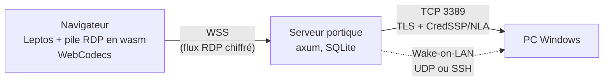

<div align="center">

# Portique

**Ton bureau Windows dans un navigateur**, sans Java, sans guacd, sans plugin.


</div>

Portique est un client RDP web auto-hébergé, écrit en Rust de bout en bout. Le serveur établit la connexion
authentifiée avec le PC, puis ne fait que relayer les octets. C'est le navigateur qui décode l'image (wasm
et WebCodecs). La pile RDP est **écrite à partir des spécifications Microsoft**, sans aucune crate RDP
tierce.

Il est conçu pour remplacer Apache Guacamole quand on veut quelque chose de léger :

|  | Guacamole | Portique |
|---|---|---|
| Côté serveur | Tomcat (Java) + guacd (C) | un binaire Rust, image de 103 Mo |
| Décodage de l'image | sur le serveur, réencodée en PNG/JPEG | dans le navigateur ; H.264 décodé par le GPU du client |
| Identifiants Windows | envoyés à guacd | ne quittent jamais le serveur (NLA faite côté serveur) |
| Presse-papier | texte | texte, HTML et images, dans les deux sens |

## Fonctions

- **Affichage EGFX** : ClearCodec, Planar, RemoteFX Progressive, **H.264 AVC420 et AVC444** (v1/v2) décodés
  par WebCodecs (accélération matérielle quand le navigateur la propose). Conversion BT.709 pleine plage
  faite dans le wasm.
- **Presse-papier synchronisé** : texte Unicode, HTML et images, dans les deux sens.
- **Affichage adaptatif** : résolution dynamique (la session suit la fenêtre), multi-écran (une fenêtre par
  écran), plein écran avec capture du clavier (Alt+Tab, touche Windows…), Ctrl+Alt+Suppr depuis le menu de
  session.
- **Fiabilité** : reconnexion automatique, appli installable (PWA).
- **Wake-on-LAN** : paquet magique UDP direct, ou commande SSH sur un hôte du réseau du PC (par exemple un
  routeur MikroTik : `/tool wol interface=ether1 mac={mac}`), indispensable à travers un VPN.
- **Comptes** : mot de passe Argon2id, TOTP, passkeys (WebAuthn), rôles admin et utilisateur, accès par
  connexion. Ou **mode proxy** : Authelia, Authentik… devant, avec login intégré désactivé.
- **Préparation du PC sans rien installer** : la page `/setup/` fournit des scripts (.reg + .cmd, ou .ps1
  tout-en-un) qui activent le RDP, la NLA, le pare-feu, le H.264 4:4:4 et l'encodage matériel. Ils
  s'annulent en un clic.

## Architecture



Le serveur négocie X.224, TLS (certificat épinglé) et CredSSP/NTLMv2 avec les identifiants stockés
chiffrés. Il passe ensuite la session au navigateur, qui gère tout le reste : canaux, graphismes,
presse-papier, entrées. La même pile compile en natif et en wasm.

| Crate | Rôle |
|---|---|
| `rdp-pdu` | PDU RDP sans I/O : X.224, MCS/GCC, slow-path, fast-path, canaux statiques et dynamiques |
| `rdp-auth` | NTLMv2 et CredSSP, liés au canal TLS (la cryptographie vient de RustCrypto, rien de maison) |
| `rdp-connect` | côté serveur : TCP, négociation, TLS épinglé, NLA |
| `rdp-session` | machine à états de la session, wasm et natif |
| `rdp-gfx` | pipeline EGFX : surfaces, cache, composition, AVC444 |
| `rdp-codecs` | ZGFX, Planar, ClearCodec, NSCodec, RemoteFX Progressive |
| `rdp-clip` | presse-papier (MS-RDPECLIP) |
| `proto` | types partagés entre l'API et le front |
| `server` | API, comptes, relais WebSocket, Wake-on-LAN, fichiers statiques |
| `web` | front Leptos (CSR) : pages, moteur de session, WebCodecs |
| `rdp-probe` | sonde de diagnostic contre un vrai PC (capture, enregistrement et rejeu EGFX) |

Spécifications suivies : MS-RDPBCGR, MS-RDPEGFX, MS-RDPECLIP, MS-RDPEDISP, MS-RDPEDYC, MS-CSSP, MS-NLMP.
La séquence de connexion et les comportements mesurés sur Windows sont décrits dans
[`docs/rdp-connexion.md`](docs/rdp-connexion.md).

## Démarrage

### 1. Construire l'image

```sh
docker build -t portique:0.1.0 .
openssl rand -base64 32 > secrets/master_key   # clé de chiffrement de la base
```

### 2. Lancer

```yaml
services:
  portique:
    image: portique:0.1.0
    environment:
      PORTIQUE_PUBLIC_URL: https://rdp.example.net
      PORTIQUE_MASTER_KEY_FILE: /run/secrets/master_key
      PORTIQUE_ADMIN_PASSWORD_FILE: /run/secrets/admin_password
    secrets: [master_key, admin_password]
    volumes: ["./data:/data"]
    read_only: true
    cap_drop: [ALL]
    security_opt: ["no-new-privileges=true"]
    restart: unless-stopped
secrets:
  master_key: { file: ./secrets/master_key }
  admin_password: { file: ./secrets/admin_password }
```

L'appli s'utilise derrière un reverse proxy HTTPS : les passkeys, le presse-papier et WebCodecs exigent un
contexte sécurisé. L'exemple complet, avec Traefik, Authelia et un conteneur placé dans le réseau d'un
tunnel WireGuard, est dans [`deploy/docker-compose.example.yml`](deploy/docker-compose.example.yml).

### 3. Préparer le PC

Sur le PC Windows (Pro ou Entreprise), ouvre `https://<ton-domaine>/setup/` et lance au choix le `.ps1`, ou
le `.reg` puis le `.cmd`. Le script affiche l'empreinte SHA-256 du certificat RDP. À la première connexion,
un admin la compare à celle affichée par Portique, puis l'approuve.

## Configuration

Chaque secret accepte `VAR` ou `VAR_FILE` (Docker secrets). Définir les deux à la fois est refusé.

| Variable | Défaut | Rôle |
|---|---|---|
| `PORTIQUE_PUBLIC_URL` | requis | URL publique : origine des passkeys et du WebSocket |
| `PORTIQUE_MASTER_KEY(_FILE)` | requis | 32 octets en base64, chiffre les secrets en base |
| `PORTIQUE_ADMIN_PASSWORD(_FILE)` | aucun | crée le compte `admin` au premier démarrage (mode intégré, 12 caractères minimum) |
| `PORTIQUE_AUTH_MODE` | `builtin` | `builtin` (mot de passe, TOTP, passkeys) ou `proxy` |
| `PORTIQUE_TRUSTED_PROXIES` | aucun | IP, CIDR ou nom d'hôte (ex. `traefik`) des proxys de confiance |
| `PORTIQUE_PROXY_USER_HEADER` | `Remote-User` | en-tête de l'identifiant en mode proxy |
| `PORTIQUE_PROXY_GROUPS_HEADER` | `Remote-Groups` | en-tête des groupes |
| `PORTIQUE_PROXY_ADMIN_GROUP` | aucun | groupe qui donne le rôle admin |
| `PORTIQUE_LISTEN` | `0.0.0.0:8080` | adresse d'écoute |
| `PORTIQUE_DATA_DIR` | `/data` | base SQLite |
| `PORTIQUE_STATIC_DIR` | `/app/web` | front compilé |
| `PORTIQUE_INSECURE_COOKIES` | aucun | `1` = cookies sans `Secure` (développement en HTTP seulement) |

**Mode proxy.** Le login intégré est désactivé. Les comptes sont créés à la volée à partir de `Remote-User`,
et le rôle admin est resynchronisé à chaque requête. Seuls les proxys de confiance peuvent fournir ces
en-têtes. Le proxy doit authentifier **toutes** les requêtes vers Portique : une règle `bypass`, par exemple
pour le réseau local, laisse passer les requêtes sans `Remote-User`, et l'API répond alors 401.

## Sécurité

- NLA obligatoire, CredSSP v5 ou plus (CVE-2018-0886), NTLMv2 avec MIC et liaison au canal TLS.
- Certificat du PC épinglé après approbation par un admin.
- Identifiants Windows chiffrés en base (XChaCha20-Poly1305) ; ils ne sont jamais envoyés au navigateur.
- CSP stricte : seul le script d'amorce du wasm est autorisé, par son empreinte.
- Cookies `SameSite=Strict`, en-tête anti-CSRF et contrôle d'origine du WebSocket.
- Limitation des tentatives de connexion, réauthentification pour modifier la 2FA.
- Session RDP coupée dès que la session web est révoquée ou que l'accès est retiré.
- Budgets de mémoire et de CPU sur tout ce qui vient du PC (surfaces, cache, régions H.264).

Pour signaler une faille, voir [SECURITY.md](SECURITY.md).

## Feuille de route

La V1 (`v0.1.0`) couvre l'usage bureau quotidien. Pour la suite :

- transcodage HEVC/AV1 sur le serveur (NVENC, QSV, VAAPI, SVT-AV1), au choix comme un réglage de qualité ;
- son, micro, transfert et copier-coller de fichiers ;
- confort mobile (trackpad, barre de touches, multi-touch), HiDPI et zoom ;
- client SSH, partage et enregistrement de session.

## Développement

Prérequis : Rust stable (1.90 ou plus), cible `wasm32-unknown-unknown`, [trunk](https://trunkrs.dev).
`./scripts/ci.sh` lance toutes les vérifications ; `./scripts/release.sh X.Y.Z` publie une version
(image, archive, release GitHub) depuis le poste, sans CI ; `./scripts/publish-dev.sh` republie l'image
de branche `ghcr.io/neotoxicfr/portique:dev` après chaque livraison sur `dev`.

```sh
cargo test --workspace --exclude portique-web
cargo clippy --workspace --exclude portique-web --all-targets
cargo clippy -p portique-web --target wasm32-unknown-unknown
(cd crates/web && trunk build --release --dist ../../dist)
PORTIQUE_PUBLIC_URL=http://localhost:18431 PORTIQUE_LISTEN=127.0.0.1:18431 PORTIQUE_DATA_DIR=./data \
PORTIQUE_STATIC_DIR=./dist PORTIQUE_INSECURE_COOKIES=1 PORTIQUE_MASTER_KEY=$(openssl rand -base64 32) \
PORTIQUE_ADMIN_PASSWORD=change-me-please cargo run -p portique-server
```

Les contributions sont bienvenues : voir [CONTRIBUTING.md](CONTRIBUTING.md) et le
[code de conduite](CODE_OF_CONDUCT.md).

## Remerciements

Les spécifications ouvertes de Microsoft (Open Specifications) font foi. [IronRDP](https://github.com/Devolutions/IronRDP)
et [FreeRDP](https://github.com/FreeRDP/FreeRDP) ont servi de référence pour lever des ambiguïtés. Aucun code
n'en est repris.

## Licence

Au choix : [MIT](LICENSE-MIT) ou [Apache-2.0](LICENSE-APACHE).
